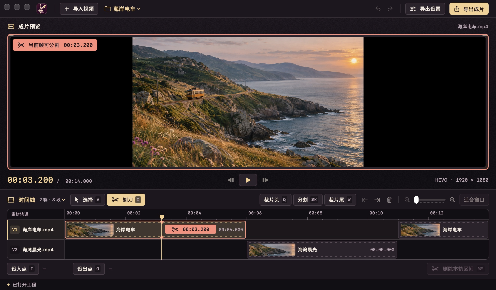
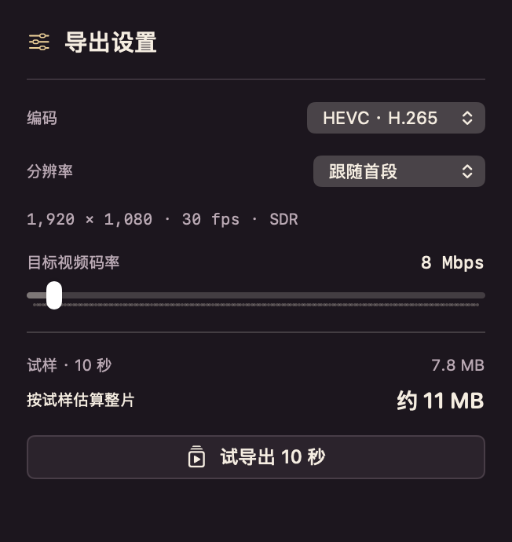

<p align="center">
  
</p>

<h1 align="center">剪一刀</h1>

<p align="center">
  <strong>Mac 上的本地视频快剪工具</strong><br>
  裁掉片头片尾，删去中间一段，把几段视频拼成一个 MP4。
</p>

<p align="center">
  <sub>Apple 芯片 · macOS 14 或更新版本 · v0.1.7</sub><br>
  <a href="#暗房工作区">暗房工作区</a> ·
  <a href="#快速上手">快速上手</a> ·
  <a href="#导出成片">导出成片</a> ·
  <a href="#从源码构建">从源码构建</a>
</p>

## 暗房工作区



预览置于窗口中央，胶片时间线用素材缩略图展示片段顺序。剃刀对准当前暂停帧时，剪点和预览框同时亮起。拖动片段时，金色插入线指示松手后的落点。截图使用原创生成的演示画面。

## 快速上手

1. **拖入素材。** 把视频拖进窗口，或按 `⌘I` 多选文件。每个素材进入独立轨道，按导入顺序接到成片末尾。
2. **找到剪点。** 拖动标尺定位，双指捏合可围绕指针缩放。左右方向键逐帧移动，上下方向键跳到相邻剪点。
3. **裁切和拼接。** 按 `C` 切到剃刀，点按片段分割。按 `V` 切回选择，拖动片段改顺序。用 `⌘S` 保存 `.qingjian` 工程。

想先试一遍完整流程？按 `⌘O` 打开仓库自带的**裁切与拼接**工程。它用两段合成测试视频组成一个 7 秒时间线，打开后可直接试剪。[示例工程](Examples/裁切与拼接.qingjian)

<details>
<summary>剪辑快捷键</summary>

| 操作 | 快捷键 |
| --- | --- |
| 播放或暂停 | `空格` |
| 选择或剃刀 | `V` / `C` |
| 裁片头、裁片尾 | `Q` / `W` |
| 在播放头处分割 | `⌘K` |
| 设入点、设出点、删除本轨选区 | `I` / `O` / `⌘⌫` |
| 删除选中片段 | `⌫` |
| 缩放时间线、适合窗口 | `=` / `-` / `⇧Z` |
| 撤销、重做 | `⌘Z` / `⇧⌘Z` |

</details>

## 导出成片

**先看十秒，再决定整片大小。** 在右上角打开「导出设置」，选一段有小字或快速运动的画面，点击「试导出 10 秒」。看过试样的画质和实际体积后，再调码率并导出整片。

<p align="center">
  
</p>

| 想怎么导出 | 对应设置 |
| --- | --- |
| **快速保留原编码** | 素材规格一致、剪点落在关键帧时，可选「快速无损」直接复制视频和音频码流。 |
| **按当前剪点精确导出** | 选择 HEVC 或 H.264，导出 MP4。分辨率可跟随首段，也可选 2160p、1440p 或 1080p。 |
| **先核对画质和大小** | 调整目标视频码率，短片试导出后按实际体积估算整片。 |

想看具体耗时与同帧画质对照，可查看 M1 MacBook Air 上的测试记录。[4K 导出实测](Tests/Reports/4K导出实测.md)

<details>
<summary>格式兼容、工程与缓存</summary>

- 工程记录素材路径、剪点、轨道、顺序和导出设置。重新打开时需要原素材，源文件可放在外接盘。
- 系统能解码的素材直接读取。部分 MKV、TS、AVI、WebM 文件会创建本地兼容副本，可在「文件 → 兼容缓存位置」指定磁盘。应用正常退出时会清理本次缓存。
- 快速无损适用于规格一致、关键帧对齐的 H.264 或 HEVC。有声素材还要求相同规格的 AAC 音轨。单段素材可先核对缩短到关键帧的范围，再决定导出方式。
- 压缩导出采用 Rec.709 SDR。有声音时输出双声道 AAC，优先采用素材的默认或启用音轨。多音轨、内嵌字幕和 HDR 信息以原素材为准。

</details>

## 从源码构建

需要 Apple 芯片 Mac、macOS 14 或更新版本，以及 Xcode 命令行工具。仓库随附 Apple 芯片版媒体工具，克隆后可在本机离线构建。

```bash
git clone https://github.com/cooper-dev-404/jian-yi-dao.git
cd jian-yi-dao
bash build.sh
open "build/剪一刀.app"
```

构建脚本会生成本地签名的 `build/剪一刀.app`。要从 Launchpad 或访达启动，将应用包拖入「应用程序」。

## 当前进展

- **0.1.7 工作区**加入暗房界面、胶片缩略图、双指缩放、剃刀剪点反馈和拖放插入提示。
- **剪辑流程**覆盖本地导入、多轨素材、裁切拼接、撤销重做、工程存取与短片试导出。
- **回归样片**覆盖混合帧率、延迟音轨、兼容缓存、快速无损和 4K 压缩导出。

```bash
bash Tests/run.sh
```

[应用源码](Sources/) · [示例工程](Examples/) · [测试与样片](Tests/) · [第三方组件](Assets/ThirdParty.txt)
