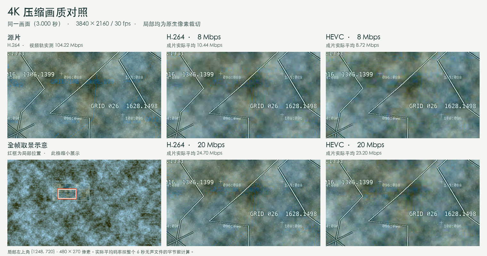

# 剪一刀 0.1.1 · 4K 导出实测

在 Apple M1 MacBook Air（16 GB 内存、macOS 27.2.1）上，用发布版对应的引擎导出本地合成素材。以下均为单次测量，MB 按 1,000,000 字节计算。

## 压缩体积与画质

用同一段 6 秒的 3840 × 2160、30 fps、无声 SDR 视频比较四种设置。源文件为 78.17 MB 的 H.264 视频，含平移的小字、细线、纹理和独立运动区域。每份成片保持原分辨率，均有 180 帧，逐帧展示时间与源文件一致。

| 编码 | 目标视频码率（Mbps） | 文件大小（MB） | 实际总码率（Mbps） | 导出耗时（秒） | 亮度 PSNR（dB） | 亮度 SSIM |
| --- | ---: | ---: | ---: | ---: | ---: | ---: |
| HEVC | 8 | 6.54 | 8.72 | 3.82 | 32.44 | 0.8090 |
| HEVC | 20 | 17.40 | 23.20 | 3.63 | 38.54 | 0.9528 |
| H.264 | 8 | 7.83 | 10.44 | 3.31 | 32.06 | 0.8058 |
| H.264 | 20 | 18.53 | 24.70 | 3.40 | 37.13 | 0.9420 |

在这段有细字和运动的画面里，HEVC 从 20 降到 8 Mbps，使文件从 17.40 MB 缩到 6.54 MB，局部纹理也有损失。实际总码率由导出文件的字节数和时长计算，短片的实测平均值会偏离设定值。画质指标取每六帧中的一帧，共比较 30 帧的原始亮度平面。PSNR 使用亮度均方误差，SSIM 取 8 × 8 区块的平均值，两项数值越高表示与源片越接近。

## 长时间线与混合帧率

- 从一份 15 分钟、3840 × 2160、30 fps 的无声合成素材中取三段，各 40 秒。按 HEVC、20 Mbps、原分辨率导出后，成片恰为 120 秒、23.92 MB。导出耗时 68.42 秒，约为实时速度的 1.75 倍。独立读取 MP4 包，逐个核对了 3,600 帧的展示时间和帧时长。此素材画面简单，压缩结果与上面的高细节样片相差较大。
- 以 60 fps 为项目帧率，取自 30 fps 素材的 1 秒试样导出了 60 帧。反向测试中，以 4K、30 fps 为项目规格，从 1440p、60 fps 素材导出的 0.6 秒试样保持 4K，共 18 帧。两组试样均逐帧核对展示时间。
- 剪辑器回归同时覆盖了片段修改、项目存取、试样体积测量、整片大小估算、取消导出，以及设置或剪辑变化后旧估算的清除。

本次使用合成素材。真实 20–30 GB 视频的持续读写、外接盘速度、长时间编码时的温度影响，以及不同拍摄内容下的主观画质仍待实测。压缩输出范围为 Rec.709 SDR。
